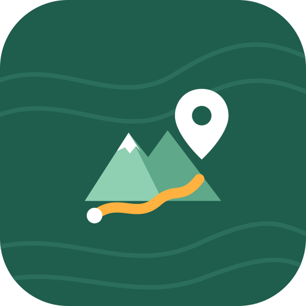
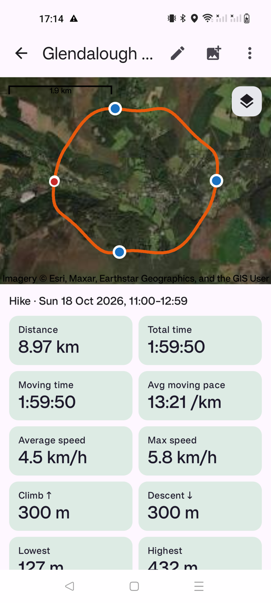

<p align="center"></p>

<h1 align="center">TrackLog</h1>

<p align="center">A private GPS track recorder for Android, for walks, hikes, runs and rides.<br>Your tracks, notes and photos stay on your phone.</p>

<p align="center">
  <a href="https://github.com/twcollins/tracklog/releases/latest"><b>⬇ Download the APK</b></a>
</p>

<p align="center">
  
</p>

## Features

- **Record tracks** in the background with a foreground service. Pause and resume, and pick up an unfinished recording after a restart.
- **Live stats:** distance, time, moving time, pace or speed, altitude, climb and descent. GPS jitter, altitude noise and impossible jumps are filtered out.
- **Notes and photos:** add geotagged notes while recording, or take photos that are geotagged and pinned to the track. You can also attach existing photos afterwards; they're placed by their EXIF location or by time.
- **Organise** your tracks by activity (walk, hike, run, cycle, paddle, ski, drive) with search, filters and sorting.
- **Elevation and speed charts** for each track.
- **Maps (opt-in):** OpenStreetMap, OpenTopoMap (contours) or Esri satellite imagery. Switch layers from a button on the map. With maps off, tracks are drawn offline.
- **Import and export** GPX, and export KML.
- Metric or imperial units, and portrait or landscape layouts.

## Privacy

- Everything is stored in the app's private storage on the phone. Android cloud backup and device transfer are turned off.
- Location comes straight from the phone's GPS chip. There is no Google Play Services, analytics, crash reporting or account.
- The only network use is **map images**, and only if you turn maps on. Map providers see your IP address and which area you're viewing. Your tracks are never uploaded.
- Nothing leaves the phone unless you export a GPX or KML file yourself.

## Install on a phone

1. On the phone, open the [latest release](https://github.com/twcollins/tracklog/releases/latest) and download `tracklog-<version>.apk`.
2. Open the downloaded file. If Android asks, allow your browser or file manager to **install unknown apps**.
3. Tap **Install**. Requires Android 8.0 or newer.
4. On first use, allow location ("While using the app") and notifications.
5. For reliable recording with the screen off, go to **Settings → Battery optimisation settings** and set TrackLog to **Unrestricted** / **Don't optimise**.

Or from a computer with `adb`: `adb install tracklog-<version>.apk`

## Build from source

Requires JDK 17 and the Android SDK (platform 35).

```sh
./gradlew testDebugUnitTest assembleRelease
# → app/build/outputs/apk/release/app-release.apk
```

Built with Kotlin, Jetpack Compose, Room and [osmdroid](https://github.com/osmdroid/osmdroid). Map data © OpenStreetMap contributors; OpenTopoMap (CC-BY-SA); imagery © Esri and its partners.
